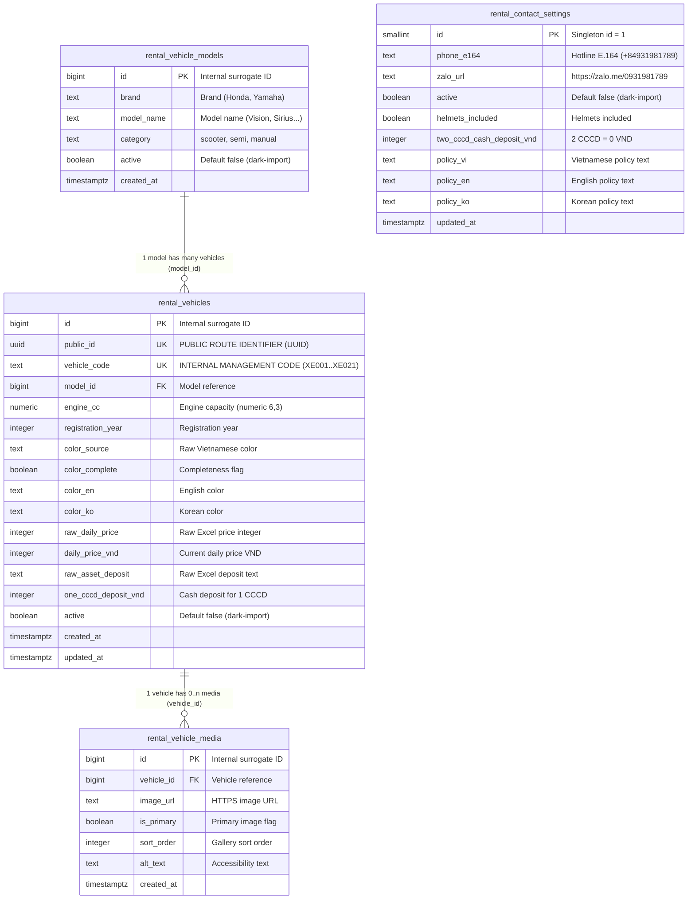

# Rental database proposal V2.1 — OWNER REVIEW REQUIRED

2026-10-13. **DRAFT V2.1, SQL NOT EXECUTED.** This proposal incorporates V2.1 final corrections based on technical review: flexible price data design (dropping rigid formula CHECK from DDL), default dark-import visibility (`active DEFAULT false`), concrete VI/EN/KO contact policies, clean Public DTO boundary omitting internal keys, media future-proofing without schema changes, and a strict 4-stage deployment gate. No rental tables or data were created. Preserve the existing places/analytics database and the independent Motorbike Rental booking system.

## Revision history

- **V1 (2026-10-13):** Initial 4-table proposal draft (`rental_vehicle_models`, `rental_vehicles`, `rental_vehicle_media`, `rental_contact_settings`) with `source_code`, formula constraint `CHECK (daily_price_vnd = raw_daily_price * 1000)`, and `active DEFAULT true`.
- **V2 (2026-10-13):** Replaced `source_code` with `vehicle_code` as an internal management key (`XE001`–`XE021`), retained `public_id` (UUID) as the public route key, and prohibited `vehicle_code` exposure in Public API and visitor UI.
- **V2.1 (2026-10-13 - Current):**
  - **FIX 1 (Price Data Design):** Removed rigid DDL constraint `CHECK (daily_price_vnd = raw_daily_price * 1000)` to allow future administrative price updates on `daily_price_vnd` without constraint failures. The 1:1000 scale is asserted exclusively during initial import ingestion. Both `raw_daily_price > 0` and `daily_price_vnd > 0` remain strictly enforced.
  - **FIX 2 (Default Visibility & Dark-Import):** Set `active BOOLEAN NOT NULL DEFAULT false` on `rental_vehicle_models`, `rental_vehicles`, and `rental_contact_settings`. Initial data import does not expose any rental items to visitors until an explicit Owner activation gate is authorized.
  - **FIX 3 (Contact Policy VI/EN/KO):** Formulated exact localized policy text satisfying all NOT NULL constraints in `rental_contact_settings`. Korean copy marked pending native human review.
  - **FIX 4 (Public DTO Consistency):** Strictly omits `vehicle_code`, internal bigint IDs, and raw import values. Media projection omits internal IDs.
  - **FIX 5 (Media Future-Proofing):** Zero-media supported natively; responsive 80×80 card and 4:3 detail placeholders; partial unique index enforces at most one primary image; adding real photos later requires zero schema migration.
  - **FIX 6 (Security & 4-Stage Separation):** Separated into 4 isolated phases: D1 (Schema DDL), D2 (Data Import with active=false), D3 (API Integration), D4 (Production Activation).

## Live schema audit (SELECT only)

Evidence: `../RENTAL_REVIEW_2026-10-13/recovery-2026-10-13/neon-schema-select.json` relative to repository. One SELECT reads information_schema, pg_indexes, pg_constraint, row-security flags and effective privileges; no venue or analytics row export.

Seven public tables exist: administrative_units, analytics_events, place_tags, place_translations, places, tag_translations, tags. No rental tables. Existing names use snake_case; places.id is integer with owned sequence default. Existing imported timestamps use timestamp without time zone. Existing tables have RLS disabled. Full column/constraint/index definitions are in the evidence.

The local credential can SELECT and INSERT places and CREATE in public. This is **not** least-privilege runtime access; no permissions were changed. The code's SELECT validator is defense in depth, not a database privilege boundary. Before future integration, Owner must approve a separate migration credential and restricted server-side runtime role. Do not expose either to the browser. Audit did not prove all role memberships or Production Worker credential equality.

Reuse the existing server-side repository → adapter → API → view-model pattern. Add a separate rental repository; do not join rental data into discovery or change its ranking. API must project only public fields, enforce active flags, parameterize filters and sanitize errors. No client SQL or direct client Neon access.

## Entity design

Use four tables. Models identify manufacturer/model/category; physical vehicles retain their own year, cc, color and prices because those differ even within a model. Contacts are a singleton. Media belongs to the **physical vehicle**, preventing the wrong color/photo being reused across a model. No booking, payments, identity documents, contracts or live availability columns.



Internal identity IDs must be DB-generated; `public_id` UUID is a stable opaque route key for all client-facing requests. `vehicle_code` is an internal management key (retaining verified `XE001`–`XE021` for operational tracking and auditability against the physical workbook); it is UNIQUE, NOT NULL, but strictly internal. It is **never** exposed in Public Rental API responses or displayed to visitors on vehicle cards or detail views. Do not use license plate as a public key. This proposal intentionally stores no plate or CCCD at all.

Engine cc is numeric(6,3), preserving 124.8/149.3/110.3. Registration year is not manufacture year. New service timestamps use timestamptz with server defaults; this does not reinterpret existing naive workbook timestamps. `active` means advertised/published, never available now. Both model and vehicle must be active to appear on public views.

Price is per vehicle, integer VND/day. `raw_daily_price` records the original Excel source value for auditability. `daily_price_vnd` is the operational daily rental price in VND. In V2.1, the rigid DDL formula constraint `daily_price_vnd = raw_daily_price * 1000` is removed to allow flexible business price updates in the future without DDL friction; initial 1:1000 consistency is verified by the importer ingestion assertion. Cash deposit is a separate per-vehicle approved amount under the one-CCCD condition; two CCCD means zero cash deposit under Owner's policy. No asset-deposit value is added to the daily rental price.

## DDL preview V2.1 — NOT EXECUTED

No IF NOT EXISTS: a collision must fail for review rather than silently accepting an incompatible table. No extension installation or change to existing tables. `gen_random_uuid()` availability must be verified with a read-only catalog query before approval/execution; otherwise generate UUIDs in the approved importer.

```sql
CREATE TABLE rental_vehicle_models (
 id bigint GENERATED ALWAYS AS IDENTITY PRIMARY KEY,
 brand text NOT NULL CHECK (btrim(brand) <> ''),
 model_name text NOT NULL CHECK (btrim(model_name) <> ''),
 category text NOT NULL CHECK (category IN ('scooter','semi','manual')),
 active boolean NOT NULL DEFAULT false,
 created_at timestamptz NOT NULL DEFAULT current_timestamp,
 UNIQUE (brand, model_name)
);

CREATE TABLE rental_vehicles (
 id bigint GENERATED ALWAYS AS IDENTITY PRIMARY KEY,
 public_id uuid NOT NULL DEFAULT gen_random_uuid() UNIQUE,
 vehicle_code text NOT NULL UNIQUE CHECK (btrim(vehicle_code) <> ''),
 model_id bigint NOT NULL REFERENCES rental_vehicle_models(id) ON DELETE RESTRICT,
 engine_cc numeric(6,3) NOT NULL CHECK (engine_cc > 0),
 registration_year integer NOT NULL CHECK (registration_year BETWEEN 1900 AND 2100),
 color_source text NOT NULL CHECK (btrim(color_source) <> ''),
 color_complete boolean NOT NULL DEFAULT true,
 color_en text,
 color_ko text,
 raw_daily_price integer NOT NULL CHECK (raw_daily_price > 0),
 daily_price_vnd integer NOT NULL CHECK (daily_price_vnd > 0),
 raw_asset_deposit text NOT NULL,
 one_cccd_deposit_vnd integer NOT NULL CHECK (one_cccd_deposit_vnd >= 0),
 active boolean NOT NULL DEFAULT false,
 created_at timestamptz NOT NULL DEFAULT current_timestamp,
 updated_at timestamptz NOT NULL DEFAULT current_timestamp
);

CREATE INDEX rental_vehicles_model_idx ON rental_vehicles(model_id);

CREATE TABLE rental_vehicle_media (
 id bigint GENERATED ALWAYS AS IDENTITY PRIMARY KEY,
 vehicle_id bigint NOT NULL REFERENCES rental_vehicles(id) ON DELETE RESTRICT,
 image_url text NOT NULL CHECK (image_url ~ '^https://[^[:space:]]+$'),
 is_primary boolean NOT NULL DEFAULT false,
 sort_order integer NOT NULL DEFAULT 0 CHECK (sort_order >= 0),
 alt_text text NOT NULL CHECK (btrim(alt_text) <> ''),
 created_at timestamptz NOT NULL DEFAULT current_timestamp,
 UNIQUE (vehicle_id, image_url)
);

CREATE UNIQUE INDEX rental_media_primary_idx
 ON rental_vehicle_media(vehicle_id) WHERE is_primary;

CREATE INDEX rental_media_order_idx
 ON rental_vehicle_media(vehicle_id, sort_order, id);

CREATE TABLE rental_contact_settings (
 id smallint PRIMARY KEY CHECK (id = 1),
 phone_e164 text NOT NULL CHECK (phone_e164 ~ '^\+[1-9][0-9]{7,14}$'),
 zalo_url text NOT NULL CHECK (zalo_url ~ '^https://zalo[.]me/[0-9]+$'),
 active boolean NOT NULL DEFAULT false,
 helmets_included boolean NOT NULL DEFAULT true,
 two_cccd_cash_deposit_vnd integer NOT NULL DEFAULT 0
   CHECK (two_cccd_cash_deposit_vnd = 0),
 policy_vi text NOT NULL CHECK (btrim(policy_vi) <> ''),
 policy_en text NOT NULL CHECK (btrim(policy_en) <> ''),
 policy_ko text NOT NULL CHECK (btrim(policy_ko) <> ''),
 updated_at timestamptz NOT NULL DEFAULT current_timestamp
);
```

Small initial catalog does not justify price/ranking indexes or full-text search. Unique constraints create their own indexes. The FK model index and ordered media index serve expected joins. No index is added to existing tables. No trigger is proposed; future privileged editing service updates `updated_at` explicitly.

## Image updates & media future-proofing

Zero media rows is completely valid. Future images are Owner-supplied; no scraping or search. Order primary DESC, sort_order ASC, id ASC; if no primary, first ordered media is used. A partial unique index allows at most one primary per vehicle. Replace primary inside one future authorized transaction by clearing the old flag then setting the new one. Validate approved CDN host, HTTPS, content type, file size, dimensions and ownership before insertion. SQL URL checks alone do not prove safe content/ownership. Do not store expiring signed tokens in permanent URLs.

Responsive 80×80 card and 4:3 detail slots reserve geometry, lazy decode offscreen images and fall back on failure without breaking the layout. Store actual media per vehicle; any future model-level sharing requires an explicit override contract. Image transformations/CDN/storage are out of current scope. When Owner provides photos for physical vehicles in the future, inserting rows into `rental_vehicle_media` requires zero schema alterations or downtime.

## Mapping and import preview

Source is the already-preserved safe fixture `src/lib/rental/vehicles.preview.json` extracted from the Owner workbook. SHA256: `919635B35655BCB3D65DED57C3EEFAD6390E770DE2D39E84663823C7C153E02B`.

Companion `RENTAL_IMPORT_PREVIEW.json` contains 21 safe mapped rows and 8 models, plus confirmed contact/policy input. It is **not an executable importer**, contains no plates and has not been sent to Neon. Per-row mapping: `code`→`vehicle_code` (internal management key), `brand`/`model`→`model_id` via returned DB identity, `category`→`model.category`, `engineCc`→`numeric`, `registrationYear`→`registration_year`, `color`→`color_source`, `rawDailyPrice`→`raw_daily_price` and `daily_price_vnd`, `rawAssetDeposit`→`raw_asset_deposit`. Deposit is category-specific approved cash policy. XE011 `color_complete=false`. Translation fields remain null pending reviewed translations; do not guess an ambiguous source color such as “Xanh”.

Future importer contract, only after explicit write approval:

1. Validate JSON/hash, exact 21 distinct vehicle codes (`XE001`–`XE021`), 8 unique brand/model pairs, category counts 10/10/1; model category must agree across all its rows.
2. Ingest assertion: for every row, assert `daily_price_vnd = raw_daily_price * 1000` and positive prices. No plate/CCCD/image fields allowed.
3. In one atomic transaction, assert intended rental tables empty or use a separately approved incremental-import contract. Never overwrite existing rows or skip collisions.
4. Insert 8 models with parameterized values and `active = false` (RETURNING `id`, `brand`, `model_name`); map each physical row from returned IDs.
5. Insert 21 vehicles with parameterized values and `active = false`.
6. Insert singleton contact settings with `active = false` and full `policy_vi`, `policy_en`, `policy_ko`.
7. Insert **zero** media. No writes to places, tags, translations, administrative_units or analytics_events.
8. Assert model/vehicle/contact counts, categories, prices/deposits, uniqueness, FK integrity, no missing model, `active = false` on all rows, and zero media. Roll back on any failure; no silent retry or ON CONFLICT DO NOTHING.

```sql
-- Parameterized importer statements, NOT EXECUTED.
INSERT INTO rental_vehicle_models(brand, model_name, category, active)
VALUES ($1, $2, $3, false) RETURNING id, brand, model_name;

INSERT INTO rental_vehicles
 (vehicle_code, model_id, engine_cc, registration_year, color_source,
 color_complete, raw_daily_price, daily_price_vnd, raw_asset_deposit,
 one_cccd_deposit_vnd, active)
VALUES ($1,$2,$3,$4,$5,$6,$7,$8,$9,$10,false)
RETURNING id, public_id, vehicle_code;

INSERT INTO rental_contact_settings
 (id, phone_e164, zalo_url, active, helmets_included, two_cccd_cash_deposit_vnd,
  policy_vi, policy_en, policy_ko)
VALUES (1, $1, $2, false, true, 0, $3, $4, $5);
```

## Public API DTO and read query previews — NOT EXECUTED

Public clients and visitors must never receive internal database IDs, `vehicle_code`, or raw Excel import columns.

```sql
-- Public catalog projection: strictly omit vehicle_code, internal ID, and raw fields.
-- Only active items are projected.
SELECT v.public_id, m.brand, m.model_name, m.category,
 v.engine_cc, v.registration_year, v.color_source, v.color_complete,
 v.color_en, v.color_ko, v.daily_price_vnd, v.one_cccd_deposit_vnd
FROM rental_vehicles v JOIN rental_vehicle_models m ON m.id = v.model_id
WHERE v.active = true AND m.active = true AND ($1::text IS NULL OR m.category = $1)
ORDER BY m.brand, m.model_name, v.id;

-- Public vehicle media query: parameterized by public_id.
-- Omits internal bigint media ID; exposes only presentation fields.
SELECT x.image_url, x.alt_text, x.is_primary, x.sort_order
FROM rental_vehicle_media x JOIN rental_vehicles v ON v.id = x.vehicle_id
JOIN rental_vehicle_models m ON m.id = v.model_id
WHERE v.public_id = $1::uuid AND v.active = true AND m.active = true
ORDER BY x.is_primary DESC, x.sort_order, x.id;

-- Post-import validation assertions:
SELECT count(*) AS vehicles, count(DISTINCT vehicle_code) AS vehicle_codes,
 count(DISTINCT public_id) AS public_ids,
 count(*) FILTER (WHERE active = false) AS inactive_vehicles
FROM rental_vehicles;

SELECT m.category, count(*) FROM rental_vehicles v
JOIN rental_vehicle_models m ON m.id = v.model_id GROUP BY m.category;

SELECT count(*) AS orphans FROM rental_vehicle_media x
LEFT JOIN rental_vehicles v ON v.id = x.vehicle_id WHERE v.id IS NULL;
```

### TypeScript Public DTO Specification

```typescript
export interface PublicVehicleMediaDTO {
  imageUrl: string;
  isPrimary: boolean;
  sortOrder: number;
  altText: string;
}

export interface PublicRentalVehicleDTO {
  publicId: string;            // UUID v4
  brand: string;
  model: string;
  category: "scooter" | "semi" | "manual";
  engineCc: number;
  registrationYear: number;
  color: string;               // Localized color string
  colorComplete: boolean;
  dailyPriceVnd: number;
  oneCccdDepositVnd: number;   // Explicitly condition-named
  media?: PublicVehicleMediaDTO[];
}
```

## Security, rollback and 4-stage deployment workflow

Credentials remain server-only. Runtime role should have `SELECT` only on explicitly approved rental public tables; migration/admin role kept separate. The existing broad credential must not be used in runtime Workers. No permission changes are executed now.

The deployment of the Rental feature must follow 4 distinct, independently approved stages:

1. **Stage D1 — Schema Migration (DDL):** Execute DDL V2.1 in a single transaction on Neon to create the 4 empty tables with constraints and indexes. Failure rolls back cleanly.
2. **Stage D2 — Data Import (Dark-Import):** Run the transactional Python import script to populate 8 models, 21 vehicles, and singleton contact settings with `active = false` and 0 media rows. Verify exact assertions. At this stage, zero items are exposed publicly.
3. **Stage D3 — API Integration & Verification:** Implement the server-side repository and `/api/rentals` route. Verify against staging / preview environment that inactive records return an empty list and active mock records serialize conforming DTOs.
4. **Stage D4 — Production Activation & Feature Gate:** Following Owner review and visual verification on physical devices, execute an authorized activation statement (`UPDATE ... SET active = true`) and enable the rental promotion component on Production.

Destructive rollback: If needed before public release, drop newly created tables in reverse dependency order (`rental_vehicle_media` → `rental_vehicles` → `rental_vehicle_models` + `rental_contact_settings`). Never drop or cascade into existing venue or analytics tables.

## Owner review needed before proceeding

1. Approval of DDL V2.1 with removed formula CHECK constraint and `active DEFAULT false`.
2. Review and acceptance of localized contact policies (`policy_vi`, `policy_en`, `policy_ko`). Korean copy requires human review before international marketing.
3. Authorization of Stage D1 (Schema Migration) when ready.

Next gate: review this proposal with Owner and ChatGPT. **Do not execute DDL/import or deploy.**
